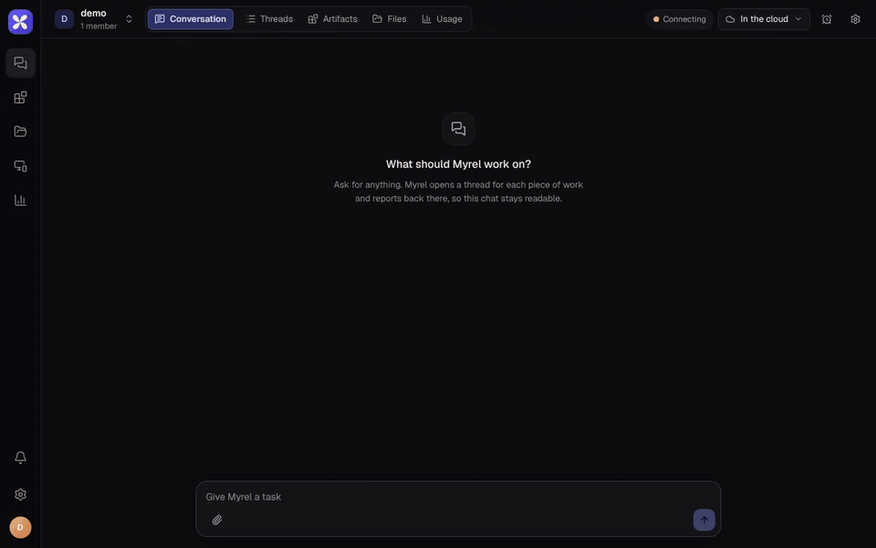
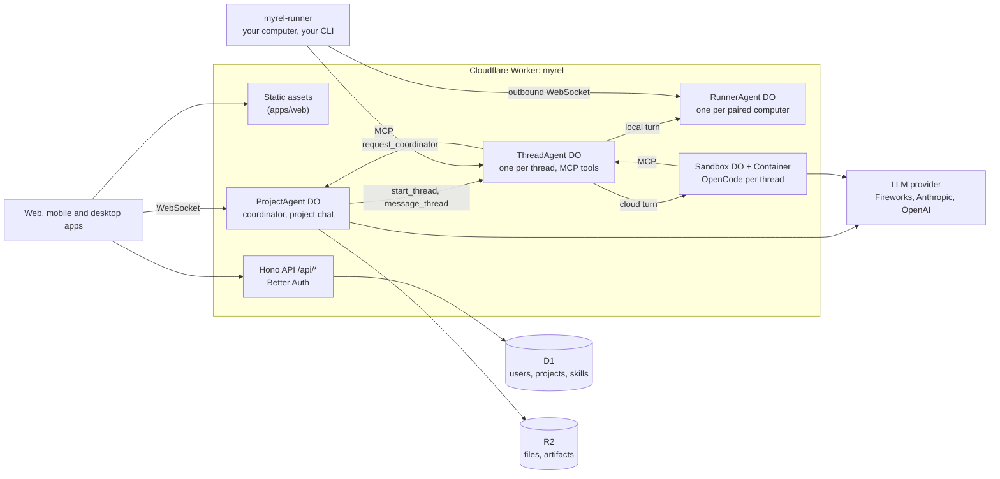

<p align="center">
  
</p>

<h1 align="center">Fibteq Myrel</h1>

<p align="center">
  <strong>An open-source, self-hostable workspace where AI agents do the work inside your projects.</strong>
</p>

<p align="center">
  <a href="LICENSE"></a>
  <a href="https://github.com/Fibteq-Inc/myrel/releases/latest"></a>
  <a href="https://play.google.com/store/apps/details?id=io.fibteq.myrel"></a>
  <a href="https://www.npmjs.com/package/myrel-runner"></a>
  <a href="https://github.com/Fibteq-Inc/myrel/actions/workflows/ci.yml"></a>
</p>

<p align="center">
  <a href="https://myrel.fibteq.io">Try it</a> ·
  <a href="https://docs.myrel.fibteq.io">Docs</a> ·
  <a href="#download">Download</a> ·
  <a href="docs/self-hosting.md">Self-host</a> ·
  <a href="docs/architecture.md">Architecture</a> ·
  <a href="https://github.com/Fibteq-Inc/myrel/discussions">Discussions</a>
</p>



Fibteq Myrel gives a team a project chat with a coordinator agent in it. Ask for
something and the coordinator opens a thread for it; a thread agent takes the
task, shows its progress as a live checklist, and answers in the thread. When
something is beyond its scope, the thread agent asks the coordinator for
direction, much like a teammate would. Projects keep their artifacts, files and
memory in one place. The idea is close to Claude Projects, but open, multi-model
and running on your own Cloudflare account.

> **Status: early.** Projects, the coordinator and thread agents that do real
> work (in a cloud sandbox or on your own computer) are running in production
> at [myrel.fibteq.io](https://myrel.fibteq.io). Expect breaking changes. See
> the [roadmap](#roadmap).

## Why Myrel

- **Coordinator and threads.** One agent routes, many agents work. The
  coordinator never does the work itself; each thread agent owns its task,
  shows a live checklist and asks for permission or a decision when it needs one.
- **Real agents, your choice of where.** A thread's agent is a coding harness:
  OpenCode in a per-thread Cloudflare Sandbox, or your own Claude Code, Codex,
  Antigravity CLI, OpenCode, Hermes Agent, Cursor CLI, Muse Code or Kimi Code on your computer through `myrel-runner`. Your CLI logins never
  leave your computer.
- **Any model.** Fireworks, Anthropic and OpenAI out of the box, optionally
  through Cloudflare AI Gateway. Bring your own key.
- **Yours to run.** One Cloudflare Worker with Durable Objects, D1, R2 and
  Containers. No servers to manage.
- **Apps that follow you.** Web, iOS and Android apps (Android on
  [Google Play](https://play.google.com/store/apps/details?id=io.fibteq.myrel)), and a desktop app for macOS, Windows and Linux with
  the runner built in ([releases](https://github.com/Fibteq-Inc/myrel/releases)),
  all connect to any Myrel server you point them at.

## What it does

- **Project chat and threads** with decision cards, reactions and a progress
  checklist per thread.
- **Artifacts:** pages and apps an agent publishes, versioned and served from a
  separate origin.
- **Project memory and files:** instructions, memory notes and uploads every
  thread can use.
- **GitHub:** connect repositories through a GitHub App; agents clone, branch
  and open pull requests, and CI or review events wake the thread.
- **Your computer:** pair a computer with `myrel-runner`, give a project one or
  more folders, and approve access to anything outside them from the thread.
- **Skills and connectors:** Agent Skills (written in the app or taken from
  GitHub) and your own MCP servers, for yourself or per project.
- **Routines and notifications:** scheduled prompts, plus in-app, email and
  push notifications.
- **Usage:** every model call and sandbox minute metered per project and thread,
  with an estimated cost under agent replies (turns on your own computer use
  your CLI's login and show none).

## Download

- **Web:** use the hosted server at [myrel.fibteq.io](https://myrel.fibteq.io)
  or [run your own](#self-hosting).
- **Desktop (macOS, Windows, Linux):** installers are attached to the
  [latest release](https://github.com/Fibteq-Inc/myrel/releases/latest)
  (`.dmg`, `.exe`/`.msi`, `.AppImage`, `.deb`, `.rpm`). The app updates itself
  and has the runner built in.
- **Android:** [Google Play](https://play.google.com/store/apps/details?id=io.fibteq.myrel).
- **Runner only:** `npx myrel-runner pair <code>` pairs a computer without the
  desktop app (the code is in Myrel under Devices). See
  [packages/myrel-runner/README.md](packages/myrel-runner/README.md).

## Architecture



- **API**: [Hono](https://hono.dev) on Cloudflare Workers, [Better Auth](https://better-auth.com)
  (email and password, bearer tokens for apps), D1 through [Drizzle](https://orm.drizzle.team).
- **Coordinator**: one `ProjectAgent` Durable Object per project runs a small
  provider-neutral loop (`apps/api/src/llm`) that only routes.
- **Thread agents**: each turn is one harness run, OpenCode in the thread's
  [Cloudflare Sandbox](https://developers.cloudflare.com/sandbox/) or the
  person's CLI through the runner. It talks to people through Myrel's tools over
  MCP (`reply`, `update_plan`, `ask_decision`, `publish_artifact`,
  `request_coordinator`, `resolve_thread` and more), and the `ThreadAgent`
  Durable Object keeps the thread's state between turns.
- **Local runner**: `myrel-runner` (`packages/myrel-runner`) keeps an outbound
  WebSocket to a `RunnerAgent` Durable Object. See
  [packages/myrel-runner/README.md](packages/myrel-runner/README.md).
- **Realtime**: messages live in the project's Durable Object SQLite with a
  monotonically increasing `seq`, so clients resync after reconnecting.
- **Clients**: web (Vite, React 19, TanStack Router and Query, Tailwind CSS 4),
  mobile (Expo) and desktop (Tauri 2), sharing `packages/protocol`,
  `packages/client` and `packages/i18n` (English and Turkish; read
  [its README](packages/i18n/README.md) before adding UI text).

More detail is in [docs/architecture.md](docs/architecture.md).

```
apps/api           Hono Worker, Durable Objects (ProjectAgent, ThreadAgent, RunnerAgent, Sandbox)
apps/artifacts     Worker that serves artifacts from their own origin
apps/web           Vite + React SPA
apps/mobile        Expo app for iOS and Android
apps/desktop       Tauri 2 desktop app with the runner built in
packages/protocol  shared types and zod schemas
packages/client    typed API client + reconnecting project socket
packages/i18n      UI strings (en, tr) for web and mobile
packages/db        Drizzle schema and D1 migrations
packages/runner-core     harness adapters shared by the sandbox and the runner
packages/myrel-runner    @fibteq/myrel-runner, the local daemon (myrel-runner-alias: its short npm name)
docs/              self-hosting, architecture, maintainer notes
ee/                commercial features: hosted plans and billing (ee/billing)
```

## Quick start (local)

Requires Node 24.22.1+ (see `.node-version`) and pnpm 10.

```sh
pnpm install
cp apps/api/.dev.vars.example apps/api/.dev.vars    # set BETTER_AUTH_SECRET and a model key
cp apps/artifacts/.dev.vars.example apps/artifacts/.dev.vars
pnpm db:migrate:local                               # applies D1 migrations to the local database
pnpm dev                                            # API on :8787, artifacts on :8788, web on http://localhost:5173
```

Open http://localhost:5173, create an account (sign-ups are on locally), create a
project and ask for something in the project chat.

Other scripts: `pnpm typecheck`, `pnpm test`, `pnpm build`. After changing
`packages/db/src/schema.ts`, run `pnpm db:generate` to create a migration.

## Self-hosting

Myrel runs on your own Cloudflare account and deploys with
[Workers Builds](https://developers.cloudflare.com/workers/ci-cd/builds/), so
every push to your `main` branch ships. The
[self-hosting guide](docs/self-hosting.md) covers the D1 database, the build
settings, every variable and secret, model providers, AI Gateway, sign-ups and
connecting the apps.

## Roadmap

| Phase | What it adds | State |
|---|---|---|
| 0 | Monorepo, auth, D1, deploy pipeline | Done |
| 1 | Coordinator and thread agents, project chat | Done |
| 1.5 | Local `myrel-runner` with your own Claude Code, Codex, Antigravity CLI, OpenCode, Hermes Agent, Cursor CLI, Muse Code or Kimi Code | Done |
| 2 | Cloud sandbox (OpenCode), project files on R2, GitHub (clone, branch, PR) | Done |
| 3 | Artifacts, project memory, decision cards, mobile app | Done |
| 4 | Routines, notifications, MCP connectors, skills, desktop app | Done |
| 5 | Members and roles, hosted plans and billing, one-click deploy | Done except one-click deploy |

## Contributing

Contributions are welcome. Read [CONTRIBUTING.md](CONTRIBUTING.md) first; you
will be asked to sign the [Contributor License Agreement](CLA.md) on your first
pull request. Report vulnerabilities privately as described in
[SECURITY.md](SECURITY.md), and follow the [Code of Conduct](CODE_OF_CONDUCT.md).

Questions and ideas go to [Discussions](https://github.com/Fibteq-Inc/myrel/discussions).
If Myrel is useful to you, a star on GitHub helps others find it.

## License

Fibteq Myrel is open core:

- Everything outside `ee/` is licensed under the
  [GNU Affero General Public License v3.0](LICENSE) (AGPL-3.0-only). If you run
  a modified Myrel as a network service, you must offer its source to its users.
- Code in [`ee/`](ee/) is licensed under the
  [Fibteq Myrel Enterprise License](ee/LICENSE). It is source-available but
  needs a commercial license for production use.

"Fibteq" and "Fibteq Myrel" are names of Fibteq. The licenses cover the code,
not the names or logos; a fork you distribute should use its own name.
