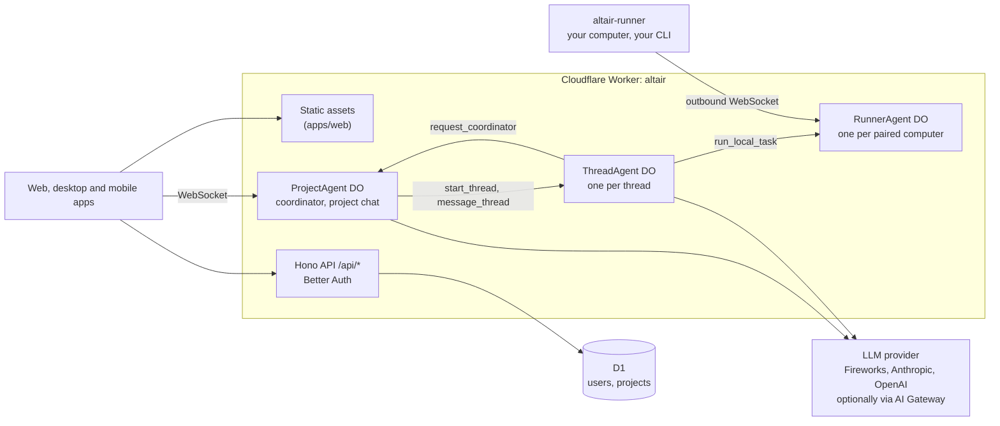

# Fibteq Altair

**An open-source, self-hostable workspace where AI agents do the work inside your projects.**

Fibteq Altair gives a team a project chat with a coordinator agent in it. Ask for
something and the coordinator opens a thread for it; a thread agent takes the
task, shows its progress as a live checklist, and answers in the thread. When
something is beyond its scope, the thread agent asks the coordinator for
direction, much like a teammate would. Projects keep their artifacts, files and
memory in one place. The idea is close to Claude Projects, but open, multi-model
and running on your own Cloudflare account.

> **Status: early (phase 1).** The project chat, coordinator and thread agents
> work end to end, but agents only talk for now: no tools, sandbox, file
> storage or web access yet. Expect breaking changes. See the [roadmap](#roadmap).

## Why Altair

- **Coordinator and threads.** One agent routes, many agents work. The
  coordinator never does the work itself; each thread agent owns its task and
  asks for permission or direction when it needs it.
- **Any model.** Fireworks, Anthropic and OpenAI out of the box, optionally
  through Cloudflare AI Gateway. Bring your own key.
- **Yours to run.** One Cloudflare Worker, Durable Objects and a D1 database.
  No servers to manage, and the free tier is enough to try it.
- **Apps that follow you.** The web app is served by the same Worker. The
  desktop and mobile apps (planned) connect to any Altair server you point them at.

## Architecture



- **API**: [Hono](https://hono.dev) on Cloudflare Workers, [Better Auth](https://better-auth.com)
  (email and password, bearer tokens for apps), D1 through [Drizzle](https://orm.drizzle.team).
- **Agents**: one `ProjectAgent` Durable Object per project runs the coordinator
  (`post_message`, `start_thread`, `message_thread`, `react`). Each thread has a
  `ThreadAgent` that does the work (`reply`, `update_status`, `request_coordinator`,
  `resolve_thread`, and `run_local_task` when the project has a local folder). Both
  use a small provider-neutral loop in `apps/api/src/llm`.
- **Local runner**: `altair-runner` (`packages/altair-runner`) runs on your computer, keeps an
  outbound WebSocket to a `RunnerAgent` Durable Object and runs tasks with your own
  Claude Code, Codex or Gemini CLI in folders you shared. Your CLI logins never leave
  your computer. See [packages/altair-runner/README.md](packages/altair-runner/README.md).
- **Realtime**: messages live in the project's Durable Object SQLite with a
  monotonically increasing `seq`, so clients resync after reconnecting.
- **Web**: Vite, React 19, TanStack Router and Query, Tailwind CSS 4.
- **Shared**: `packages/protocol` (zod schemas) and `packages/client` (fetch and
  WebSocket client for web, desktop and React Native).

More detail is in [docs/architecture.md](docs/architecture.md).

```
apps/api           Hono Worker, Durable Objects (ProjectAgent, ThreadAgent, RunnerAgent)
apps/web           Vite + React SPA
packages/protocol  message/thread/project types, WebSocket events
packages/client    typed API client + reconnecting project socket
packages/db        Drizzle schema and D1 migrations
packages/altair-runner    altair-runner, the local daemon for your own coding CLI
docs/              self-hosting, architecture, maintainer notes
ee/                enterprise features under a commercial license (empty for now)
```

## Quick start (local)

Requires Node 22+ and pnpm 10.

```sh
pnpm install
cp apps/api/.dev.vars.example apps/api/.dev.vars    # set BETTER_AUTH_SECRET and a model key
pnpm db:migrate:local                               # applies D1 migrations to the local database
pnpm dev                                            # API on :8787, web on http://localhost:5173
```

Open http://localhost:5173, create an account (sign-ups are on locally), create a
project and ask for something in the project chat.

Other scripts: `pnpm typecheck`, `pnpm test`, `pnpm build`. After changing
`packages/db/src/schema.ts`, run `pnpm db:generate` to create a migration.

## Self-hosting

Altair runs on your own Cloudflare account and deploys with
[Workers Builds](https://developers.cloudflare.com/workers/ci-cd/builds/), so
every push to your `main` branch ships. The
[self-hosting guide](docs/self-hosting.md) covers the D1 database, the build
settings, every variable and secret, model providers, AI Gateway, sign-ups and
connecting the apps.

## Roadmap

| Phase | What it adds | State |
|---|---|---|
| 0 | Monorepo, auth, D1, deploy pipeline | Done |
| 1 | Talking coordinator and thread agents | Done |
| 1.5 | Local `altair-runner`: work in a folder on your computer with your own Claude Code, Codex or Gemini CLI | Done |
| 2 | Threads that do work: sandboxed runners (OpenCode first), project files on R2, GitHub (clone, branch, PR) | Next |
| 3 | Artifacts, project memory, decision cards, mobile app (Expo) | Planned |
| 4 | Events and routines (webhooks, schedules), MCP connectors, desktop app (Tauri) | Planned |
| 5 | Members and roles, billing for the hosted service, enterprise features, one-click deploy | Planned |

## Contributing

Contributions are welcome. Read [CONTRIBUTING.md](CONTRIBUTING.md) first; you
will be asked to sign the [Contributor License Agreement](CLA.md) on your first
pull request. Report vulnerabilities privately as described in
[SECURITY.md](SECURITY.md), and follow the [Code of Conduct](CODE_OF_CONDUCT.md).

## License

Fibteq Altair is open core:

- Everything outside `ee/` is licensed under the
  [GNU Affero General Public License v3.0](LICENSE) (AGPL-3.0-only). If you run
  a modified Altair as a network service, you must offer its source to its users.
- Code in [`ee/`](ee/) is licensed under the
  [Fibteq Altair Enterprise License](ee/LICENSE). It is source-available but
  needs a commercial license for production use.

"Fibteq" and "Fibteq Altair" are names of Fibteq. The licenses cover the code,
not the names or logos; a fork you distribute should use its own name.
