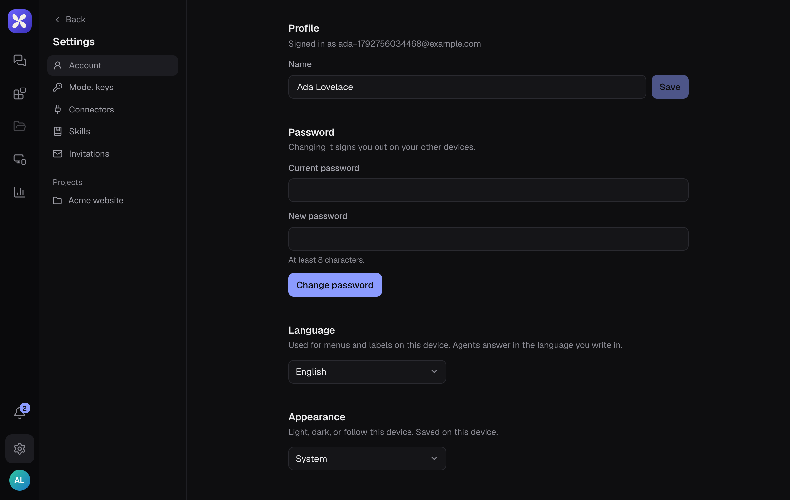

Open **Settings** with the gear icon at the bottom of the left rail.

## Account

- **Profile**: your name.
- **Password**: change it with your current password. Changing it signs you out on your other devices.
- **Language**: the language of menus and labels on this device. Myrel answers in the language you write in, whatever this is set to.
- **Appearance**: **System**, **Light** or **Dark**. Saved on this device.
- **App version** (desktop app): **Check for updates**.
- **Delete account**: deletes your account. This cannot be undone.

## Model keys

Bring your own Fireworks, Anthropic or OpenAI key: **Model keys** → **Add a key**. Then pick it in a project's **Project settings** → **Model and key**. On the hosted service, projects with their own key don't count toward plan limits.

## Invitations

Projects you were invited to. **Join** or **Decline**.

## Skills and connectors

See [Skills](/automate/skills/) and [Connectors](/automate/connectors/).
