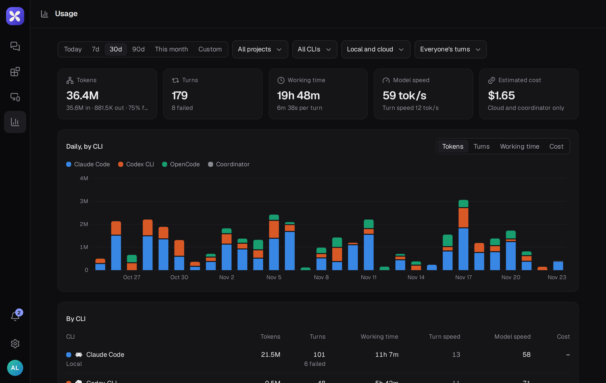

## Usage

**Usage** in the left rail shows all your projects; each project also has a **Usage** tab. Work on your own computer counts too, not only the cloud's.

The row at the top decides what the page covers: **Today**, 7, 30 or 90 days, **This month** or **Custom** dates, a project, a CLI, **Local** or **Cloud**, and **Everyone's turns** or **My turns**.

- **Totals**: tokens, turns, working time, speed and estimated cost
- **Daily, by CLI**: tokens, turns, working time or cost per day
- **By CLI** and **By project**: the same figures side by side
- **By model**, **Who spent it** (the thread agents doing the work, or the coordinator routing it) and **Top threads**

### The two speeds

Both are output tokens per second, and they answer different questions:

- **Turn speed** covers the whole turn, with the commands it ran and the time it waited for you. Every CLI has one.
- **Model speed** covers only the time the model was answering. In the cloud Myrel measures it. On your computer it needs myrel-runner 0.43.0 or newer and a CLI that reports it, which Claude Code does. Where it isn't known, a dash shows instead of a guess.

A thread's **Statistics** button, under its message box, shows both for the last turn and the thread so far. See [Threads](/work/threads/).

## The cost under a reply

Under each reply, the line shows where it ran, the model, the time, tokens and an **Estimated cost** at list prices. Select it for the details (**How this reply was made**). Work on your own computer uses your CLI's login and shows no cost.

## Plans on the hosted service

**Settings** → **Plan and billing** shows your plan: **Free**, **Pro** or **Team**, with **Upgrade**, **Start free trial** and **Manage billing**. Pro and Team have a free trial without a card.

Work on your own computer, and projects with their own model key, don't count toward plan limits. Self-hosted servers have no plans unless the server's operator turns them on.
