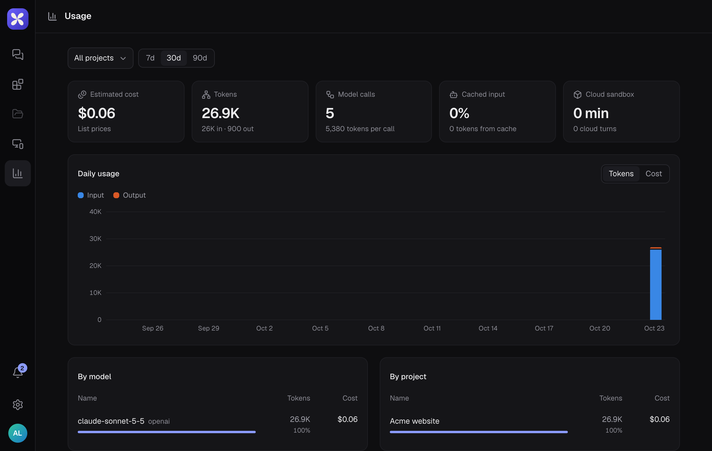

## Usage

**Usage** in the left rail shows all your projects; each project also has a **Usage** tab. Pick a **Project** and a **Range** (7, 30 or 90 days).

- **Totals**: estimated cost, tokens, model calls, cached input and cloud sandbox time
- **Daily usage**: tokens or cost per day
- **By model**, **By project**, **Who spent it** (the thread agents doing the work, or the coordinator routing it) and **Top threads**

## The cost under a reply

Under each reply, the line shows where it ran, the model, the time, tokens and an **Estimated cost** at list prices. Select it for the details (**How this reply was made**). Work on your own computer uses your CLI's login and shows no cost.

## Plans on the hosted service

**Settings** → **Plan and billing** shows your plan: **Free**, **Pro** or **Team**, with **Upgrade**, **Start free trial** and **Manage billing**. Pro and Team have a free trial without a card.

Work on your own computer, and projects with their own model key, don't count toward plan limits. Self-hosted servers have no plans unless the server's operator turns them on.
