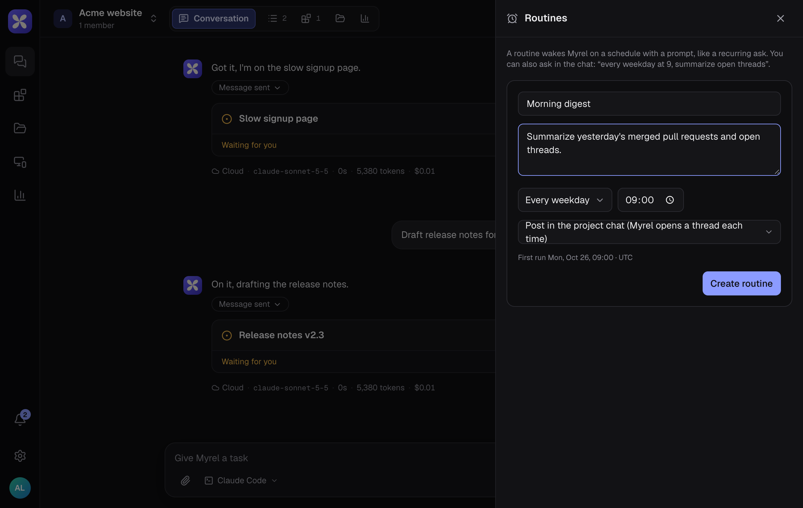

A routine wakes Myrel on a schedule with a prompt: a morning summary, a weekly report, a check next Tuesday.

## Create a routine

1. In the project, choose **Routines** (the alarm clock icon at the top right).
2. Choose **New**.
3. Give it a name and write what Myrel should do each time.
4. Under **Repeat**, choose Every weekday, Every day, Every week, Every hour, Once or Custom (cron), then the day and time.
5. Under **Where it runs**, choose where each run goes:
   - **Post in the project chat**: Myrel opens a new thread each time.
   - **Continue in** a thread: each run continues that thread.
6. Check the next run shown under the form and choose **Create routine**.

## Or just ask

Write it in the chat: "every weekday at 9, summarize open threads" or "next Monday at 10, check whether the deploy finished". Myrel sets up the routine and tells you when it first runs.

## Routines a thread sets for itself

Myrel can also schedule a later check inside a thread, for example "look again in an hour whether the deploy finished" or "check the store review tomorrow at 10". Such a routine continues that thread when it runs, shows up in the list as **in** the thread's name, and Myrel removes it once the check has done its job. You can ask for one in any thread: "remind me here on Friday to send the report".

## Manage routines

Each routine in the list shows when it runs next and when it last ran.

| Action | What it does |
|---|---|
| **Edit** | Change its name, prompt, schedule or where it runs; then **Save**. The next run follows the new schedule |
| **Run now** | Runs it right away, without changing the schedule |
| **Pause** / **Resume** | Stops and restarts it |
| **Delete** | Removes it |

You can also change a routine by asking in the chat, for example "move the morning digest to 8:30".
