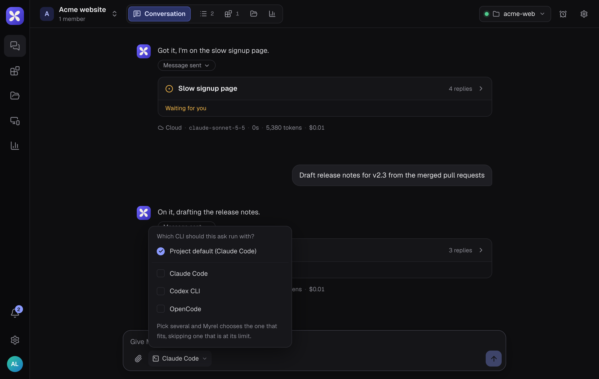

On your computer, tasks run through a coding CLI you already have.

| CLI | Command | Can ask you mid-task | Notes |
|---|---|---|---|
| Claude Code | `claude` | Yes | Asks before opening other folders or running commands it isn't allowed to |
| Codex CLI | `codex` | No | |
| Antigravity CLI | `agy` | No | A step that needs approval ends the run, which then says what stopped it |
| OpenCode | `opencode` | No | Doesn't run shell commands below **Full access** |
| Hermes Agent | `hermes` | No | Needs `hermes pm install --extra acp` once |
| Cursor CLI | `cursor-agent` | No | Below **Full access**, commands run in Cursor's sandbox, without network |
| Muse Code | `muse` | No | Below **Full access**, it writes only in the project's main folder |
| Kimi Code | `kimi` | No | Doesn't run shell commands below **Full access** |

Install the CLI and sign in to it before you pair the computer. CLIs that can't ask mid-task stay inside the project's folders, so add any folder they need under **Also allowed** ([Folders](/computer/folders/)).

## The project's default

When you give a project its folder, you pick its **Coding CLI**. Every task uses it unless you choose otherwise.

## Pick a CLI for one ask

The CLI button under **Give Myrel a task** shows which CLI the next ask will use.

- **Project default** uses the project's CLI.
- Tick one CLI to use it for this ask.
- Tick several and Myrel picks the one that fits the task, skipping one that is at its limit. The thread then says which one it picked and why.

## Change it for a thread

In a thread, the same button reads **This thread runs with**. The change applies from the thread's next turn.

The button only shows for the person whose computer holds the project's folder, and not when the project runs **Always in the cloud**.

## Usage limits

For Claude Code and Codex, **Devices** shows how much of the 5-hour and weekly limits you have used. The CLI picker marks a CLI **near its limit** or **at its limit**.
