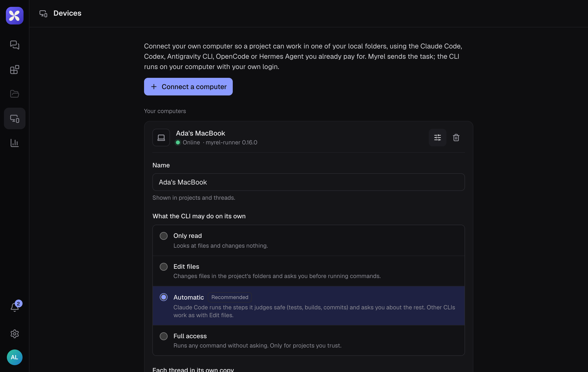

Everything about your computer is on the **Devices** page.

## Update

When a new myrel-runner is out, your computer's card shows it with an **Update** button.

- The update waits for running tasks to finish; **Update now** restarts right away, and stopped tasks continue by themselves afterwards.
- If the new version doesn't start, the computer goes back to the previous one and tells you why.

The **Update** button works for a runner installed with `npx myrel-runner service install`. A runner started in a terminal is updated by stopping it and running `npx myrel-runner@latest start`. The desktop app updates its runner with the app.

## Settings

Choose **Settings** on your computer's card.

**What the CLI may do on its own**

| Level | What it means |
|---|---|
| **Only read** | Looks at files and changes nothing |
| **Edit files** | Changes files in the project's folders and asks before running commands |
| **Automatic** (recommended) | Claude Code runs the steps it judges safe (tests, builds, commits) and asks about the rest; other CLIs work as with Edit files |
| **Full access** | Runs any command without asking. Only for projects you trust; Myrel asks you to confirm |

**Each thread in its own copy**: in a git repository, each thread works in its own worktree and branch.

**Update by itself**: installs a new myrel-runner when no task is running.

The computer has to be online to change these. To allow changes only at the computer itself, run `myrel-runner settings remote off` there.

## Usage limits

For Claude Code and Codex, the card shows the 5-hour and weekly limits, how much you used and when they reset.
