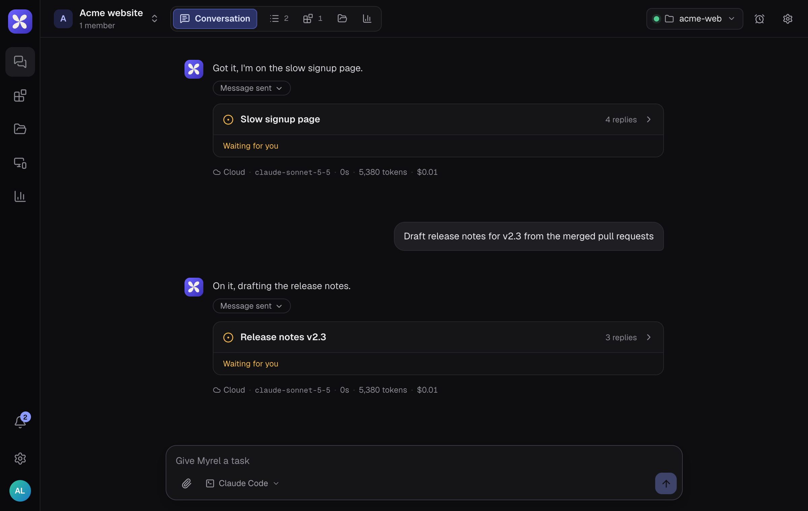
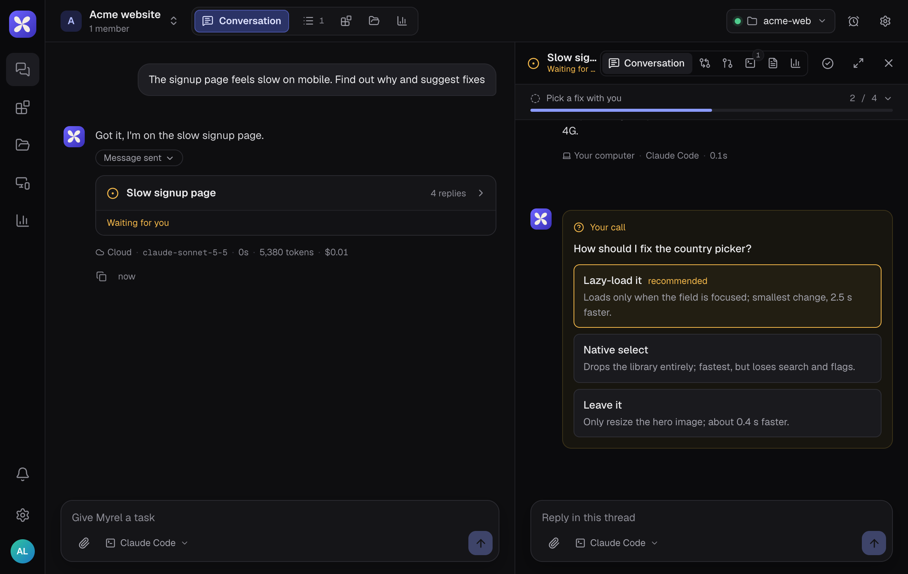

## The project chat and the coordinator

Everything starts in the project's **Conversation**. A coordinator agent reads each message and decides what to do with it:

- a new task gets its own **thread**, and the coordinator says so under your message
- a follow-up about running work is forwarded to that thread (it shows there as "Follow-up forwarded to the thread")
- a quick question may just get an answer in the chat

You can also open a thread yourself with **New request** in the sidebar, and find old ones with **Search threads**.

## Inside a thread

A thread is one task with its own agent. It shows:

- **Progress**: the agent's checklist. Steps are Not started, In progress, Done, Skipped or Failed, and a "Plan updated" card appears when it changes.
- **Decision cards** ("Your call"): when a choice is yours, the agent offers 2 to 4 options and marks one as recommended. Pick one and the agent continues.
- **Artifacts**: reports, charts or prototypes the agent publishes. They open next to the chat and also appear in the Artifacts tab.
- **How this reply was made**, under each agent reply: whether it ran in the cloud or on your computer, the model, the time, tokens and an estimated cost.

Write in **Reply in this thread** to steer the work. **Show workspace** opens the thread's workspace: Changes, Terminal (with **Stop** for a running task), Outputs, Pull request and Usage.

## Thread status

| Status | Meaning |
|---|---|
| Working | the agent is on it |
| Waiting for you | it asked you something or presented a draft |
| Checking with the coordinator | it asked for permission or routing |
| Resolved | the work is done |
| Failed | the task stopped with an error |
| Closed | closed as a duplicate, misrouted or cancelled |

Use **Resolve** when you are happy with the result. **Reopen** brings a resolved thread back; writing in a closed thread reopens it too. Nothing is deleted when a thread is closed.

## Project knowledge

Under **Files**:

- **Files**: uploads and files agents create. Attachments you add to messages land in `uploads/`.
- **Memory**: notes that every agent in the project reads. The `MEMORY` file is the index read in full on every turn; agents keep it up to date, and you can edit it.
- **Instructions**: rules every agent follows in this project.

## Routines

The **Routines** button in the project header schedules work: a prompt that runs every weekday, daily, weekly, hourly, once or on a custom cron. Each run either posts in the project chat (Myrel opens a thread each time) or continues an existing thread. To change a routine, open the panel and press the pencil on its card: you can rename it, rewrite its prompt, move it to another thread or the project chat, and change its schedule, including switching between repeating and once. The next run is worked out again from the new schedule. You can also just ask in the chat, for example "every weekday at 9, summarize open threads".

## Notifications

The bell shows when a thread finishes, replies, needs a decision, is blocked or failed. Its menu has the email and browser notification switches. The mobile app sends push notifications and the desktop app uses native ones.
