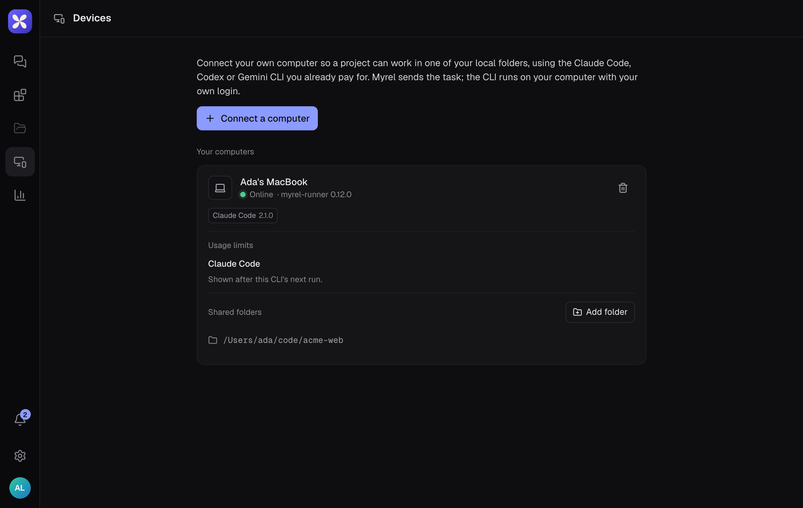

Agents can work in folders on your own machine instead of the cloud. They run through your own coding CLI (Claude Code, Codex CLI, Antigravity CLI, OpenCode or Hermes Agent), signed in with your own account, so these turns show no estimated cost and do not count toward plan limits.

The bridge between Myrel and your computer is **myrel-runner**. This page covers the steps in the app; the [myrel-runner README](https://github.com/Fibteq-Inc/myrel/blob/main/packages/myrel-runner/README.md) covers its commands and options.

## What you need

- Node.js 22 or newer
- `claude`, `codex`, `agy` (Antigravity CLI), `opencode` or `hermes` (Hermes Agent, with `hermes pm install --extra acp`) installed and signed in

## Pair the computer

1. Open **Devices** in the left rail and choose **Connect a computer**.
2. Copy the pairing command and run it in a terminal. The code works once and expires after a few minutes.
3. Run the second command shown there to keep the runner going in the background.

:::tip[Desktop app]
The runner is built in. Devices → **This computer** → **Connect this computer** pairs it in one click.
:::

## Share folders

On the Devices page, under **Shared folders**, choose **Add folder** and pick a folder. Your home folder and the disk root cannot be shared.

Then in Project settings → **Folders**, choose the project's **Main folder** and any folders it is **Also allowed** to use.

## Choose where tasks run

Project settings → General → **Run tasks**:

- **Automatic**: on the computer when a local folder is connected and the computer is online, otherwise in the cloud
- **Always on the computer**
- **Always in the cloud**

## Pick a CLI per thread

The project's folder has a default CLI. To run one ask with another, use the CLI button next to the paperclip in the project chat before you send it:

- **Project default**: the folder's CLI, as before
- **One CLI**: the thread runs with it
- **Several CLIs**: Myrel picks the one that fits, for example skipping one that is at its limit, and says which and why at the top of the thread

Inside a thread, the same button switches its CLI from the next turn. Only the person whose computer it is sees the button, with the CLIs installed there.

## When an agent needs more

Agents stay inside the project's folders. With Claude Code, the agent can ask in the thread when it needs another folder (**Allow once**, **Add to project**, **Don't allow**) or wants to run a command it is not already allowed to run (**Run it**, **Allow commands this turn**, **Don't run**). Codex, Antigravity, OpenCode and Hermes cannot ask in the middle of a run, so they stay inside the shared folders. Hermes always has its terminal: below full access, the steps it would ask about (dangerous commands, sensitive files) are declined.

## Git repositories

When the folder is a git repository, each thread works in its own git worktree on a `myrel/thr-…` branch, so threads running at the same time do not touch each other's files or your checkout.

## Updating

When a newer runner is out, its computer in **Devices** shows **Update**. The runner finishes its running tasks first (or stops them with **Update now**, and Myrel continues them), installs the new version and restarts. If the new version does not come up, the computer goes back to the previous one and the card says so. Turn on **Update by itself** in the computer's settings to have it update on its own when nothing is running.

A runner from before 0.14.0 needs `npx myrel-runner@latest update` once on the computer; after that, updates are a button. The desktop app updates its own runner with the app.

## Settings

The settings button on a computer in **Devices** opens its name, what the CLI may do on its own (**Only read**, **Edit files**, **Automatic**, **Full access**), whether each thread works in its own copy, and **Update by itself**. Changes are saved on the computer right away, so it must be online. **Full access** asks you to confirm first.

To allow changes only at the computer itself, run `myrel-runner settings remote off` there.
