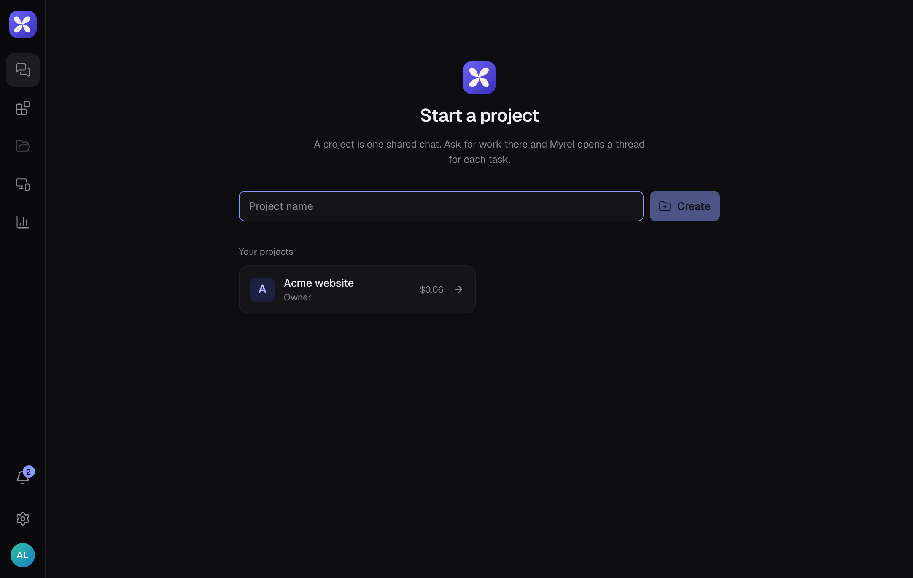
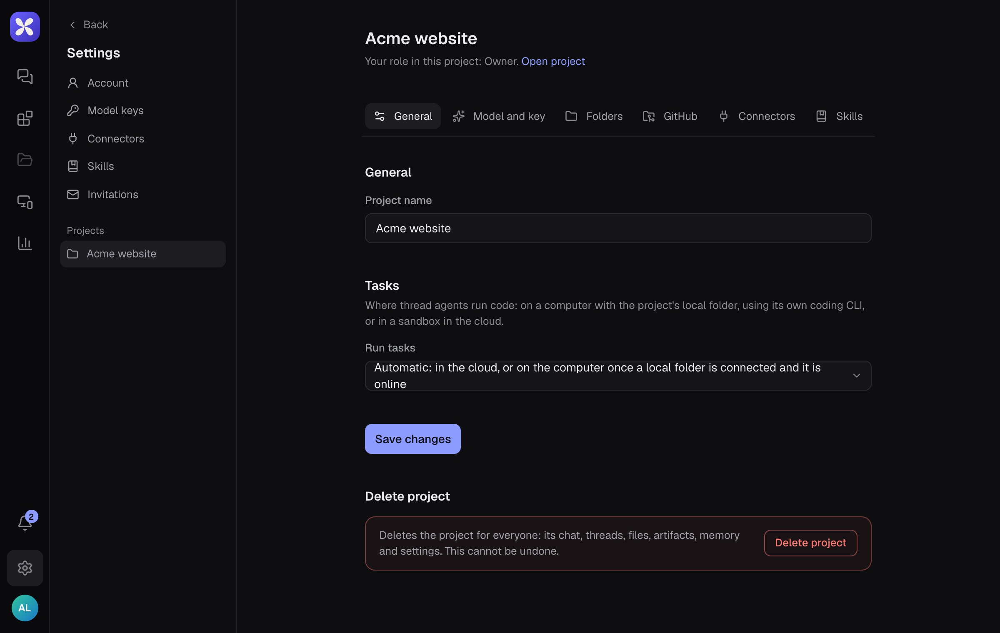

A project is one shared chat for one piece of work. Create one per product, client or goal, so its threads, files and memory stay together.

## Create it

1. Go to the Projects page (the chat icon at the top of the left rail).
2. Under **Start a project**, type a name.
3. Choose **Create**.

## Find your way around

Each project has five tabs at the top:

| Tab | What's in it |
|---|---|
| **Conversation** | The project chat, where you ask for work |
| **Threads** | Every task Myrel has worked on, with its status |
| **Artifacts** | Pages, reports and prototypes Myrel published |
| **Files** | Files, memory and project instructions |
| **Usage** | What the project used and its estimated cost |

On the right of the header are the project's folder (when [your computer](/computer/connect/) is connected), **Routines** and **Project settings**.

## Project settings

The gear icon opens the project's settings:

- **General**: the project's name, where tasks run, and deleting the project
- **Model and key**: which model and key the project uses
- **Folders**: the folders on your computer the project may use
- **GitHub**, **Connectors** and **Skills**: what the project's agents can reach
- **Members**: who is in the project

## Delete a project

**General** → **Delete project**. Type the project's name to confirm and choose **Delete forever**. This removes its chat, threads, files, artifacts, memory and settings for everyone, and cannot be undone. Only the owner can delete a project.
