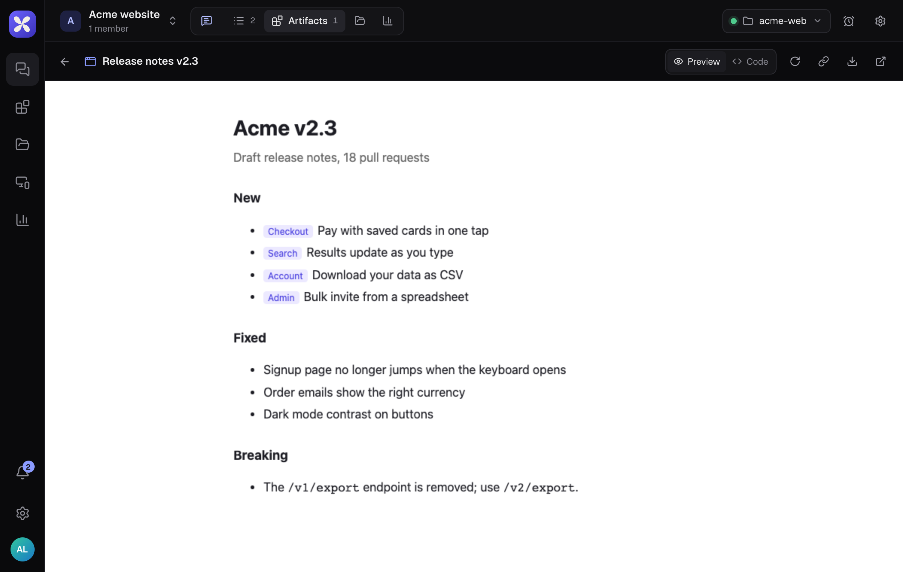

Artifacts are pages Myrel builds for you: reports, charts, comparisons, prototypes. They open right next to the chat and keep every version.

## Find them

- In the thread, as a card under the reply that published it
- In the thread's **Outputs** tab
- In the project's **Artifacts** tab
- Across all projects under **Artifacts** in the left rail, with **Search artifacts**

## In the viewer

| Control | What it does |
|---|---|
| **Preview** / **Code** | Switch between the page and its source |
| **Version** | Pick an earlier version; the newest is marked (latest) |
| **Reload** | Run the page again |
| **Copy link** | Copy a link that always opens the latest version |
| **Download HTML** | Save the page as a file |
| **Open in a new tab** | View it full size |

## Change an artifact

Reply in the thread with what to change. Myrel publishes a new version of the same artifact, and the earlier versions stay available.
