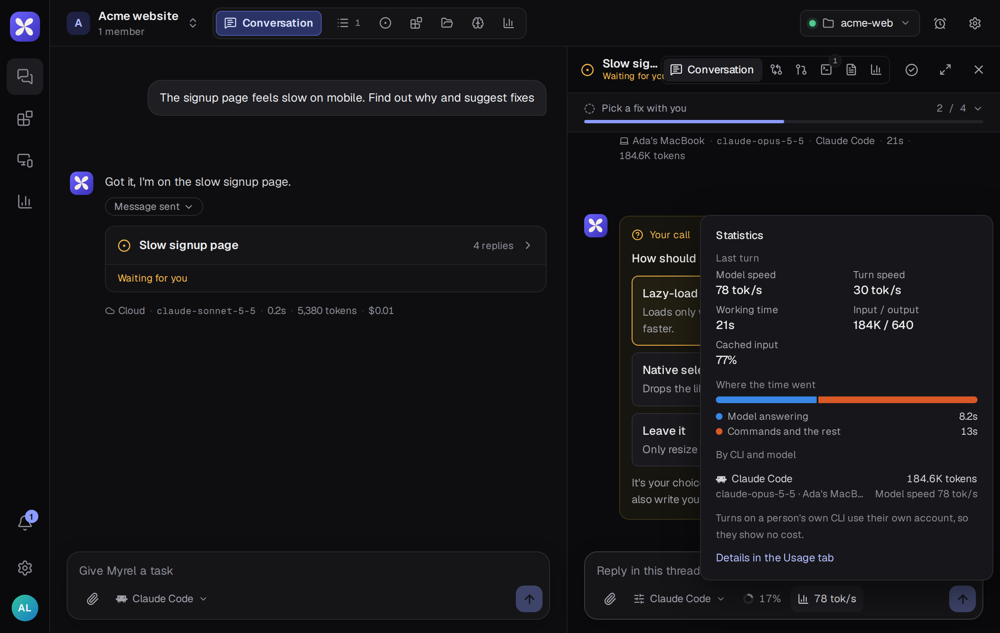
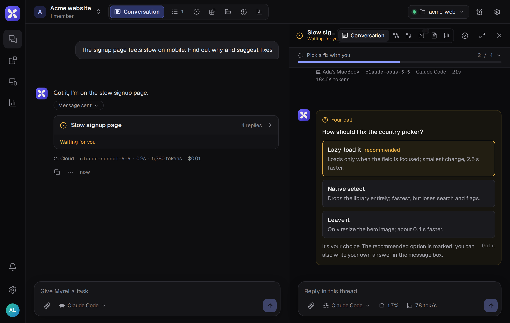

import Walkthrough from "../../../components/Walkthrough.astro";

A thread is one task. It opens next to the chat when you choose its card, and it has everything about that task: Myrel's plan, its replies, its questions and what it produced.

<Walkthrough
  name="thread"
  label="Thread walkthrough"
  steps={[
    { title: "Check the status", body: "Under the thread's name you see where it stands: <strong>Working</strong>, <strong>Waiting for you</strong>, <strong>Resolved</strong> and so on." },
    { title: "See how a reply was made", body: "Under each reply: where it ran (<strong>Cloud</strong> or <strong>Your computer</strong>), which model or CLI, how long it took and, for cloud work, an estimated cost. Select the line for the details." },
    { title: "Steer the work", body: "Write in <strong>Reply in this thread</strong> to add context, change direction or answer a question. Myrel picks it up in its next turn." },
    { title: "Look at what changed", body: "The icons at the top of the panel open the thread's workspace: <strong>Changes</strong>, <strong>Pull request</strong>, <strong>Terminal</strong>, <strong>Outputs</strong> and <strong>Usage</strong>." },
    { title: "Finish it", body: "When you are happy with the result, choose <strong>Mark resolved</strong>. You can reopen it any time." },
  ]}
/>

## The progress bar

At the top of the thread is Myrel's checklist for the task. It shows the step it is on and how many are left; open it to see every step. Steps are Not started, In progress, Done, Skipped or Failed. When the plan changes, a **Plan updated** card appears in the thread.

## Statuses

| Status | What it means | What to do |
|---|---|---|
| Working | Myrel is on it | Nothing, or reply to steer it |
| Waiting for you | It asked something or showed a draft | Answer the question or review the draft |
| Replied | It answered and asks nothing of you | Read it, write to continue, or close the thread |
| Resolved | The work is done | Reopen it if you need more |
| Failed | It stopped with an error | Reply to try again, or read the error |
| Closed | It was a duplicate or not needed | Write in it to reopen |

## The workspace

| Tab | What's in it |
|---|---|
| **Changes** | Files the task changed |
| **Pull request** | The pull request it opened, with CI and review status |
| **Terminal** | Commands it ran; **Stop** ends a running task |
| **Files** | Files from cloud work |
| **Outputs** | Artifacts and files it produced (**All outputs**) |
| **Usage** | Tokens, time, speed and estimated cost for this thread |

## Under the message box

Three buttons, each with a window of its own:

- **How this thread works**: where it runs, its CLI, model and effort. See [CLIs](/computer/clis/#change-it-for-a-thread).
- The ring with a percentage: how full the agent's context was on its last turn, what it held, and whether older messages were left out.
- **Thread statistics**: the last turn and the thread so far, where the time went (the model, waiting for permission, commands and the rest) and each CLI's share. **Details in the Usage tab** has every message.

## Panel buttons

- **Mark resolved** / **Reopen thread** change the thread's status.
- **Close thread** only closes the panel; the thread keeps its status.
- **Maximize panel** gives the thread the whole width.

Long threads have a **Jump to latest** button when you have scrolled away from the end.

